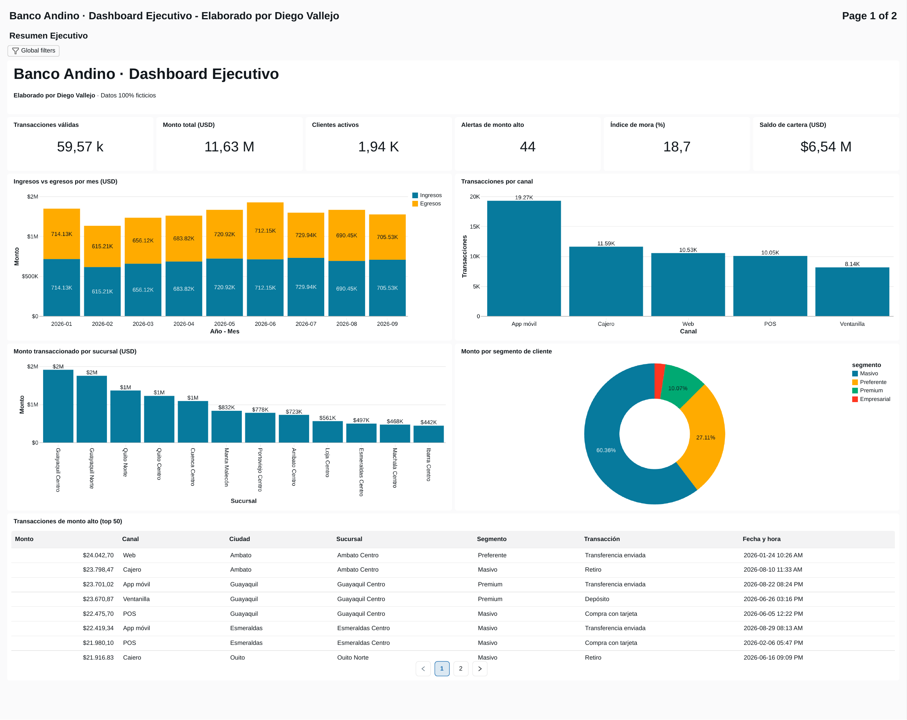
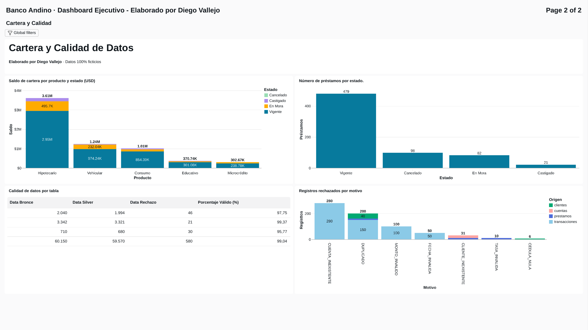
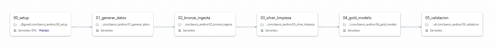
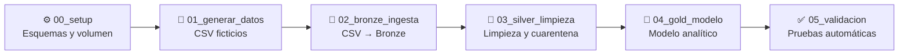
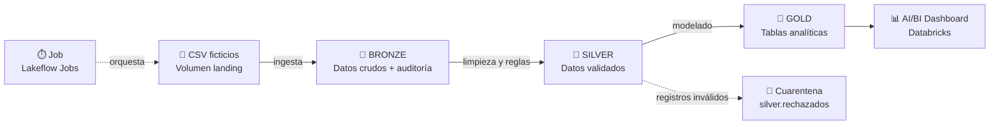

<div align="center">

# 🏦 Banco Andino · Pipeline de Datos y Dashboard Ejecutivo

### Ingeniería de datos de punta a punta en **Databricks Free Edition**
*Del archivo crudo al tablero ejecutivo: Bronze → Silver → Gold → Dashboard, orquestado con un Job*

<p>
  
  &nbsp;&nbsp;
  
  &nbsp;&nbsp;
  
  &nbsp;&nbsp;
  
  &nbsp;&nbsp;
  
  &nbsp;&nbsp;
  
</p>


### 📊 [**Ver el dashboard publicado →**](https://dbc-3926ac24-a016.cloud.databricks.com/dashboardsv3/01f1c2602ddf15318f10d1d106d83494/published?o=1445421711211396)

> 🔐 *El dashboard está publicado en Databricks Free Edition. Para abrirlo hay que iniciar sesión en Databricks; las capturas de abajo muestran el resultado completo.*

</div>

---

## 📑 Tabla de contenido

1. [Resumen del proyecto](#-resumen-del-proyecto)
2. [Dashboard](#-dashboard)
3. [Orquestación con Job](#-orquestación-con-job)
4. [Arquitectura](#-arquitectura)
5. [Herramientas y tecnologías](#-herramientas-y-tecnologías)
6. [Escenario de datos](#-escenario-de-datos)
7. [Estructura del proyecto](#-estructura-del-proyecto)
8. [Capas del pipeline](#-capas-del-pipeline)
9. [Calidad de datos](#-calidad-de-datos)
10. [Cómo reproducirlo](#-cómo-reproducirlo)
11. [Análisis de resultados](#-análisis-de-resultados)
12. [Pruebas y validación](#-pruebas-y-validación)
13. [Limitaciones y próximos pasos](#-limitaciones-y-próximos-pasos)
14. [Autor](#-autor)

---

## 🎯 Resumen del proyecto

**Banco Andino** es un banco ficticio con **12 sucursales en Ecuador**. Este proyecto simula el flujo real de un equipo de datos: recibir archivos crudos con problemas de calidad, limpiarlos, modelarlos, orquestar todo con un **Job** y publicar un **dashboard ejecutivo** dentro de Databricks.

**Preguntas de negocio que responde:**

- 💵 ¿Cuánto dinero entra y sale cada mes?
- 📱 ¿Qué canales concentran las transacciones?
- 🏢 ¿Qué sucursales y segmentos de cliente generan más actividad?
- 🚨 ¿Qué transacciones de monto alto requieren revisión?
- 💳 ¿Cuál es el saldo de la cartera de préstamos y su índice de mora?
- ✅ ¿Qué tan confiable es la data que alimenta el análisis?

**Lo que demuestra este proyecto:**

- ✔️ Arquitectura *Medallion* (Bronze / Silver / Gold) sobre **Delta Lake** y **Unity Catalog**
- ✔️ Generación de datos sintéticos con errores de calidad intencionales
- ✔️ Validación con **cuarentena de registros rechazados** y trazabilidad del motivo
- ✔️ Conciliación automática `Bronze = Silver + Rechazados`
- ✔️ **Orquestación con un Job** de 6 tareas encadenadas sobre cómputo *serverless*
- ✔️ Modelo analítico listo para BI y **dashboard con filtros globales**

---

## 📊 Dashboard

### 📈 Página 1 · Resumen Ejecutivo



### 💳 Página 2 · Cartera y Calidad de Datos



**Contenido del tablero**

| Página | Visualización | Tipo |
|---|---|---|
| 📈 Resumen | Transacciones, monto total, clientes activos, alertas, mora y saldo de cartera | 6 tarjetas KPI |
| 📈 Resumen | Ingresos vs egresos por mes | Barras |
| 📈 Resumen | Transacciones por canal | Barras |
| 📈 Resumen | Monto por sucursal | Barras |
| 📈 Resumen | Monto por segmento de cliente | Dona |
| 📈 Resumen | Transacciones de monto alto (top 50) | Tabla |
| 💳 Cartera y calidad | Saldo por producto y estado | Barras apiladas |
| 💳 Cartera y calidad | Número de préstamos por estado | Barras |
| 💳 Cartera y calidad | Calidad de datos por tabla | Tabla |
| 💳 Cartera y calidad | Registros rechazados por motivo | Barras apiladas |
| 🎛️ Global | Filtros de **Ciudad**, **Segmento** y **Mes** | Filtros globales |

> 🪪 La autoría **Diego Vallejo** aparece en el título del dashboard, en el encabezado de cada página y en la tabla `banco_gold.info_proyecto`.

---

## ⏱️ Orquestación con Job

Para automatizar el pipeline de punta a punta y evitar la ejecución manual notebook por notebook, el flujo está orquestado mediante un **Lakeflow Job de Databricks** compuesto por **6 tareas encadenadas linealmente**, ejecutadas sobre cómputo **Serverless**. Al pulsar **Run now**, el Job recrea los datos, reconstruye las capas Bronze, Silver y Gold, ejecuta las validaciones y deja las tablas Gold listas para el dashboard.

### 🖼️ Captura del Job

La captura `docs/img/job_pipeline.png` muestra el grafo del Lakeflow Job con sus seis tareas encadenadas y el cómputo Serverless.



### 🔗 Flujo de tareas



### 📋 Tareas del Job

Cada tarea ejecuta un notebook de la carpeta `banco_andino` del workspace. El nombre de la tarea coincide con el del notebook.

| # | Tarea | Qué hace | Depende de |
|:-:|---|---|---|
| 0 | `00_setup` | Crea los esquemas `banco_bronze`, `banco_silver`, `banco_gold` y el volumen `landing` | — |
| 1 | `01_generar_datos` | Genera los 5 CSV ficticios en el volumen | `00_setup` |
| 2 | `02_bronze_ingesta` | Carga los CSV como texto + auditoría a tablas Delta | `01_generar_datos` |
| 3 | `03_silver_limpieza` | Tipifica, estandariza, deduplica, valida y envía rechazos a cuarentena | `02_bronze_ingesta` |
| 4 | `04_gold_modelo` | Construye hechos, KPIs, cartera, calidad y autoría | `03_silver_limpieza` |
| 5 | `05_validacion` | Concilia filas, revisa duplicados y reglas, y comprueba Gold vs Silver | `04_gold_modelo` |

### 🧠 Decisiones de diseño

- **Cadena lineal de dependencias:** cada tarea solo arranca si la anterior terminó bien. Si una falla, el Job se detiene y no se publican datos a medias.
- **Quality Gate:** `05_validacion` es la puerta de control final. Usa aserciones y conciliaciones; si una regla falla, el Job termina en estado **FAILED** y el problema queda visible en el historial de ejecuciones antes de considerar los datos listos para BI.
- **Cómputo *serverless*:** no hay clústeres que administrar, que es lo que ofrece Free Edition.
- **Reejecutable (idempotente):** las tablas se escriben con `overwrite` y los datos se generan con semilla fija, así que correr el Job varias veces produce el mismo resultado.
- **Dashboard sin pasos extra:** los datasets del dashboard leen las tablas Gold. Después de cada ejecución del Job, un **Refresh** muestra los datos actualizados.
- **Límite de Free Edition:** admite un máximo de **5 tareas simultáneas** por cuenta. Como las tareas van en cadena, solo corre una a la vez.

### ▶️ Cómo ejecutarlo

1. En la barra izquierda, entra a **Jobs & Pipelines**.
2. Abre el Job del proyecto y pulsa **Run now**.
3. En **Runs** revisa que las 6 tareas terminen en verde.
4. Abre el dashboard y pulsa **Refresh**.

---

## 🏗️ Arquitectura de Datos · Medallion Lakehouse



| Capa | Esquema | Qué hace |
|---|---|---|
| 📥 Landing | `banco_bronze.landing` *(Volumen)* | Recibe los CSV tal como llegan |
| 🥉 Bronze | `banco_bronze` | Datos crudos como texto + `_archivo_origen` + `_ingesta_ts` |
| 🥈 Silver | `banco_silver` | Tipos correctos, estandarización, deduplicación y reglas de validación |
| 🥇 Gold | `banco_gold` | Hechos, KPIs y resúmenes listos para el dashboard |
| 📊 BI | AI/BI Dashboards | Visualización con filtros globales |
| ⏱️ Orquestación | Lakeflow Jobs | Ejecuta el pipeline de punta a punta |

---

## 🧰 Herramientas y tecnologías

| | Herramienta | Rol en el proyecto |
|:-:|---|---|
|  | **Databricks Free Edition** | Plataforma completa con cómputo *serverless* |
| 🗂️ | **Unity Catalog** | Gobierno de datos: catálogo, esquemas, tablas y volúmenes |
| 🔺 | **Delta Lake** | Formato de las tablas (ACID, historial de versiones) |
|  | **Apache Spark · PySpark** | Transformaciones Bronze → Silver → Gold |
| 🧮 | **Spark SQL** | Reglas de validación y consultas del dashboard |
|  | **Python** | Lenguaje principal de los notebooks |
|  | **pandas** | Generación de los datos sintéticos |
|  | **NumPy** | Distribuciones aleatorias reproducibles (semilla fija) |
| 📓 | **Databricks Notebooks** | Desarrollo y documentación del pipeline |
| ⏱️ | **Lakeflow Jobs** | Orquestación de las 6 tareas del pipeline |
| 📊 | **Databricks AI/BI Dashboards** | Visualización ejecutiva |
|  | **GitHub** | Versionado y publicación del proyecto |

---

## 🗃️ Escenario de datos

| Archivo | Filas aprox. | Contenido |
|---|--:|---|
| `sucursales.csv` | 12 | Sucursales, ciudad, provincia y región |
| `clientes.csv` | 2 040 | Clientes *(incluye 40 duplicados)* |
| `cuentas.csv` | 3 342 | Cuentas de ahorro y corriente |
| `transacciones.csv` | 60 150 | Movimientos de enero a septiembre de 2026 |
| `prestamos.csv` | 710 | Préstamos por producto y estado |

**Errores de calidad intencionales** (para que Silver tenga trabajo real): duplicados, cédulas nulas, ingresos negativos, segmentos con mayúsculas y minúsculas mezcladas, espacios sobrantes, montos nulos, negativos o en cero, fechas inválidas, cuentas y clientes inexistentes (claves huérfanas), tasas nulas y estados con formato distinto.

> 🔒 Todo es sintético. Las cédulas usan el prefijo `99` y los correos el dominio `ejemplo.com`. No corresponden a personas ni instituciones reales.

---

## 📁 Estructura del proyecto

La siguiente estructura refleja las carpetas principales visibles en el repositorio de GitHub y los archivos identificados en el README. Los archivos generados durante la ejecución (por ejemplo, los CSV de entrada y las tablas Delta) se crean en el entorno de Databricks y no necesariamente se versionan en Git.

```text
databricks-pyspark-lakeflow-banking-medallion/
├── README.md
├── dashboards/
│   └── Dashboard ejecutivo de Databricks AI/BI (formato Lakeview .lvdash.json)
├── data_generation/
│   └── generar_datos_local.py          # Generación local opcional de los CSV sintéticos
├── docs/
│   └── img/
│       ├── dashboard_resumen_ejecutivo.png
│       ├── dashboard_cartera_calidad.png
│       └── job_pipeline.png            # Captura del grafo de Lakeflow Job
├── notebooks/
│   ├── 00_setup.py                     # Esquemas y volumen landing en Unity Catalog
│   ├── 01_generar_datos.py             # Generación de CSV sintéticos
│   ├── 02_bronze_ingesta.py            # Ingesta cruda hacia Bronze
│   ├── 03_silver_limpieza.py           # Tipado, limpieza, reglas y cuarentena
│   ├── 04_gold_modelo.py               # Modelo analítico para el dashboard
│   └── 05_validacion.py                # Conciliaciones y pruebas automáticas
├── sql/
│   ├── dashboard_datasets.sql          # Consultas/datasets usados por el dashboard
│   └── ddl_banco.sql                   # DDL de tablas y objetos de datos
└── tests/
    └── run_local.py                    # Ejecución/pruebas locales del pipeline con PySpark
```

**Responsabilidad de cada carpeta**

- `notebooks/`: etapas ejecutables del pipeline en Databricks, desde la preparación del entorno hasta la validación.
- `data_generation/`: alternativa para generar los CSV sintéticos localmente.
- `sql/`: definiciones SQL y consultas que alimentan el dashboard.
- `tests/`: ejecución y comprobaciones locales del flujo.
- `dashboards/`: definición exportada del dashboard ejecutivo.
- `docs/img/`: capturas visuales referenciadas por este README.

## 🔄 Capas del pipeline

### 🥉 Bronze · `02_bronze_ingesta.py`
Lee los CSV **sin interpretar** (todo como texto) para no perder ningún dato sucio y agrega columnas de auditoría.

### 🥈 Silver · `03_silver_limpieza.py`
Convierte tipos, estandariza y valida. Las reglas se evalúan en orden; la primera que falla define el motivo de rechazo.

### 🥇 Gold · `04_gold_modelo.py`

| Tabla | Descripción |
|---|---|
| `fact_transacciones` | Transacción enriquecida (cliente, cuenta, sucursal, flujo, alerta de monto alto, rango de edad) |
| `kpi_mensual` | Transacciones, clientes activos, ingresos, egresos, flujo neto y alertas por mes |
| `cartera_prestamos` | Cartera por producto, estado, ciudad y segmento |
| `resumen_sucursal` | Cuentas, clientes y monto transaccionado por sucursal |
| `resumen_segmento` | Clientes, ingreso promedio y monto por segmento |
| `calidad_datos` · `rechazos_por_motivo` | Calidad de datos y motivos de rechazo |
| `info_proyecto` | Autoría, versión y última ejecución |

---

## ✅ Calidad de datos

| Tabla | Reglas de validación |
|---|---|
| `clientes` | Sin duplicados · cédula obligatoria · ingreso negativo → nulo · segmento normalizado |
| `cuentas` | Sin duplicados · el cliente debe existir |
| `transacciones` | Sin duplicados · fecha válida · monto > 0 · la cuenta debe existir · tipo válido |
| `prestamos` | Sin duplicados · el cliente debe existir · tasa válida · monto válido · estado válido |

Cada registro rechazado se guarda en `banco_silver.rechazados` con la **tabla de origen**, la **llave**, el **motivo** y el **registro completo en JSON**, de modo que nada se pierde y todo es auditable.

---

## 🚀 Cómo reproducirlo

1. 📥 En Databricks, importa los 6 notebooks de `notebooks/` a una carpeta `banco_andino`.
2. ⏱️ Crea el Job con las 6 tareas encadenadas (ver [Orquestación con Job](#-orquestación-con-job)) y pulsa **Run now**. *(Alternativa manual: ejecuta los notebooks en orden 00 → 05 con cómputo Serverless.)*
3. 🧮 Crea los datasets del dashboard con `sql/dashboard_datasets.sql`.
4. 📊 Construye los gráficos y los filtros globales (Ciudad, Segmento, Mes).
5. 🚀 Pulsa **Publish**, copia el enlace desde **Share → Copy link** y pégalo en el encabezado de este README.
6. 🖼️ Guarda las capturas en `docs/img/` con los nombres indicados.

> 💡 Si tu catálogo no se llama `workspace`, reemplaza ese nombre en las consultas de `sql/dashboard_datasets.sql`. El notebook `00_setup` imprime el nombre exacto.

---

## 🔎 Análisis de resultados

> Cifras tomadas del dashboard y de las tablas Gold (Databricks · datos sintéticos). Los totales de ingresos y egresos provienen de `gold.kpi_mensual`, y los porcentajes son cálculos propios a partir de esas cifras.

### 1️⃣ Indicadores generales

| Indicador | Valor | Lectura |
|---|--:|---|
| Transacciones válidas | **59 570** | De 60 150 recibidas, se conserva el 99,04 % |
| Monto total | **US$ 11,63 M** | Volumen transaccionado entre enero y septiembre de 2026 |
| Clientes activos | **≈ 1,94 K** | Casi todos los 1 994 clientes válidos transaccionaron |
| Alertas de monto alto | **44** | Transacciones iguales o superiores a US$ 5 000 |
| Índice de mora | **18,7 %** | Saldo en mora o castigado sobre el saldo total de cartera |
| Saldo de cartera | **US$ 6,54 M** | Suma de los saldos de capital |

### 2️⃣ Flujo de dinero: ingresos vs egresos

- La actividad es **estable mes a mes**: el monto mensual se mueve entre ≈ US$ 1,13 M (febrero, el mes más corto) y ≈ US$ 1,43 M (junio).
- En los nueve meses, los **ingresos suman ≈ US$ 6,23 M** y los **egresos ≈ US$ 5,40 M**, con un **flujo neto positivo de ≈ US$ 0,83 M**. Los ingresos representan cerca del **54 %** del monto total.
- **Junio es el único mes con flujo neto prácticamente nulo (≈ −US$ 1,3 K)**, porque sus egresos igualan a sus ingresos. Es el mes que conviene revisar primero.
- Hay **muchas más transacciones de egreso que de ingreso, pero de menor tamaño**: los depósitos y las transferencias recibidas tienen tickets más altos que las compras y los pagos.

### 3️⃣ Canales

| Canal | Transacciones | Participación |
|---|--:|--:|
| 📱 App móvil | 19,27 K | ≈ 32,3 % |
| 🏧 Cajero | 11,59 K | ≈ 19,5 % |
| 🌐 Web | 10,53 K | ≈ 17,7 % |
| 💳 POS | 10,05 K | ≈ 16,9 % |
| 🏦 Ventanilla | 8,14 K | ≈ 13,7 % |

- La **App móvil es el canal líder**, con casi una de cada tres transacciones.
- **App móvil + Web suman ≈ 50 %**: la mitad de la operación ya es digital.
- La **ventanilla es el canal menos usado (≈ 14 %)**: hay espacio para migrar esa demanda a canales de menor costo.

### 4️⃣ Sucursales

- Las **dos sucursales de Guayaquil (Centro y Norte) lideran** con cerca de **US$ 2 M cada una**.
- Le siguen **Quito Norte, Quito Centro y Cuenca Centro** (≈ US$ 1 M cada una), y luego Manta Malecón (≈ US$ 832 K), Portoviejo Centro (≈ US$ 778 K) y Ambato Centro (≈ US$ 723 K).
- Las **cuatro últimas** son Loja Centro (≈ US$ 561 K), Esmeraldas Centro (≈ US$ 497 K), Machala Centro (≈ US$ 468 K) e **Ibarra Centro (≈ US$ 442 K)**, que cierra el ranking: las sucursales líderes mueven cerca de **cuatro veces más** que la última.
- Hay una **fuerte concentración geográfica en Guayaquil**, coherente con que sea la ciudad con más clientes del escenario.

### 5️⃣ Segmentos de clientes

| Segmento | Participación del monto |
|---|--:|
| Masivo | 60,36 % |
| Preferente | 27,11 % |
| Premium | 10,07 % |
| Empresarial | ≈ 2,46 % |

- Masivo y Preferente concentran casi el **88 %** del monto.
- 🧪 **Observación metodológica:** la participación del monto coincide casi exactamente con la composición de clientes (≈ 59,7 % / 28,0 % / 9,9 % / 2,4 %). Esto ocurre porque en los datos sintéticos el monto de una transacción no depende del segmento. En un banco real se esperaría que Premium y Empresarial pesaran bastante más que su número de clientes.

### 6️⃣ Alertas de monto alto

- Se detectaron **44 transacciones** con monto igual o superior a US$ 5 000. El dashboard muestra las primeras 8 de las 44 en la página 1 de la tabla; entre ellas, los montos van de US$ 21,9 K a US$ 24,0 K.

| # | Monto | Canal | Sucursal | Segmento | Transacción |
|:-:|--:|---|---|---|---|
| 1 | US$ 24 042,70 | Web | Ambato Centro | Preferente | Transferencia enviada |
| 2 | US$ 23 798,47 | Cajero | Ambato Centro | Masivo | Retiro |
| 3 | US$ 23 701,02 | App móvil | Guayaquil Centro | Premium | Transferencia enviada |
| 4 | US$ 23 670,87 | Ventanilla | Guayaquil Centro | Premium | Depósito |
| 5 | US$ 22 475,70 | POS | Guayaquil Centro | Masivo | Compra con tarjeta |
| 6 | US$ 22 419,34 | App móvil | Esmeraldas Centro | Masivo | Transferencia enviada |
| 7 | US$ 21 980,10 | POS | Esmeraldas Centro | Masivo | Compra con tarjeta |
| 8 | US$ 21 916,83 | Cajero | Quito Norte | Masivo | Retiro |

- 🚩 **Retiros en cajero de ≈ US$ 23,8 K y ≈ US$ 21,9 K:** montos así superan cualquier límite habitual de un cajero automático. Son **candidatos prioritarios a revisión**.
- 🚩 **Compras con tarjeta en POS de ≈ US$ 22 K:** un ticket de ese tamaño es atípico para ese canal, cuyo valor mediano es de decenas de dólares.
- 🚩 **5 de las 8 alertas son de clientes del segmento Masivo**, cuyo ingreso mensual típico es de varios cientos de dólares. Un movimiento de más de US$ 20 K es desproporcionado frente a ese perfil.

### 7️⃣ Cartera de préstamos

| Producto | Saldo | Participación |
|---|--:|--:|
| Hipotecario | US$ 3,61 M | ≈ 55 % |
| Vehicular | US$ 1,24 M | ≈ 19 % |
| Consumo | US$ 1,01 M | ≈ 15 % |
| Educativo | US$ 370,7 K | ≈ 6 % |
| Microcrédito | US$ 302,7 K | ≈ 5 % |

| Estado del préstamo | Cantidad | Porcentaje |
|---|--:|--:|
| Vigente | 479 | 70,4 % |
| Cancelado | 98 | 14,4 % |
| En mora | 82 | 12,1 % |
| Castigado | 21 | 3,1 % |

- El **crédito hipotecario concentra más de la mitad de la cartera** (≈ 55 %), lo que implica una exposición alta a un solo producto.
- El **índice de mora por saldo es 18,7 %**. Por número de préstamos, los que están en mora o castigados son el **15,2 %** de los 680 válidos.
- El **saldo no vigente** (en mora o castigado) pesa entre **15 % y 21 %** en todos los productos:

| Producto | Saldo vigente | Saldo total | % no vigente |
|---|--:|--:|--:|
| Vehicular | US$ 974,2 K | US$ 1,24 M | ≈ 21 % |
| Microcrédito | US$ 238,8 K | US$ 302,7 K | ≈ 21 % |
| Educativo | US$ 301,1 K | US$ 370,7 K | ≈ 19 % |
| Hipotecario | US$ 2,95 M | US$ 3,61 M | ≈ 18 % |
| Consumo | US$ 854,4 K | US$ 1,01 M | ≈ 15 % |

- En Hipotecario, el saldo **en mora** es ≈ US$ 496 K, y el saldo **castigado** representa ≈ US$ 164 K adicionales (diferencia entre el total y las demás barras).
- Un índice cercano al 19 % es **muy elevado** para una cartera bancaria y justificaría revisar las políticas de originación y cobranza.

### 8️⃣ Calidad de los datos

| Tabla | Recibidas (Bronze) | Válidas (Silver) | Rechazadas | % válido |
|---|--:|--:|--:|--:|
| Clientes | 2 040 | 1 994 | 46 | 97,75 % |
| Cuentas | 3 342 | 3 321 | 21 | 99,37 % |
| Préstamos | 710 | 680 | 30 | 95,77 % |
| Transacciones | 60 150 | 59 570 | 580 | 99,04 % |

**Rechazos por motivo (677 en total):**

| Motivo | Registros | % de rechazos |
|---|--:|--:|
| `CUENTA_INEXISTENTE` | 280 | ≈ 41 % |
| `DUPLICADO` | 200 | ≈ 30 % |
| `MONTO_INVALIDO` | 100 | ≈ 15 % |
| `FECHA_INVALIDA` | 50 | ≈ 7 % |
| `CLIENTE_INEXISTENTE` | 31 | ≈ 5 % |
| `TASA_INVALIDA` | 10 | ≈ 1 % |
| `CEDULA_NULA` | 6 | ≈ 1 % |

- Desglose de los rechazos por tabla de origen (visible en el gráfico apilado): `CUENTA_INEXISTENTE` son 280 de **transacciones**; `DUPLICADO` suma 200 (**150** transacciones, **40** clientes y **10** préstamos); `CLIENTE_INEXISTENTE` suma 31 (**21** cuentas y **10** préstamos); `MONTO_INVALIDO` y `FECHA_INVALIDA` son solo de transacciones; `TASA_INVALIDA` (10) es de préstamos y `CEDULA_NULA` (6) de clientes.
- La calidad global es **alta (≥ 95 % válido en todas las tablas)**. **Préstamos es la tabla más débil (95,77 %)**.
- **Cuenta inexistente y duplicados explican ≈ 71 % de los rechazos.**
- Parte de los rechazos por cuenta inexistente es un **efecto cascada**: cuando un cliente se rechaza, sus cuentas se rechazan por cliente inexistente y sus transacciones por cuenta inexistente. Corregir el origen (cédulas nulas y claves huérfanas) reduciría varios motivos a la vez.

### 🧭 Conclusiones y recomendaciones

1. 📱 **Canales:** reforzar la app móvil y migrar demanda desde ventanilla.
2. 🏢 **Sucursales:** analizar por qué Loja, Esmeraldas, Machala e Ibarra (todas bajo US$ 600 K) están muy por debajo de Guayaquil, antes de decidir inversión o cierre.
3. 💳 **Riesgo:** investigar el 18,7 % de mora, empezando por Vehicular y Microcrédito, y revisar la concentración en hipotecario.
4. 🚨 **Fraude:** revisar de inmediato las alertas de montos cercanos a US$ 24 K, en especial el retiro en cajero.
5. 🧹 **Datos:** validar claves en origen (cliente, cuenta, cédula) para prevenir los rechazos en cascada.
6. 📅 **Junio:** revisar qué ocurrió en el único mes con flujo neto casi nulo.

---

## 🧪 Pruebas y validación

- `tests/run_local.py` ejecuta los 6 notebooks y las 11 consultas del dashboard con **PySpark 4.0** (ANSI SQL activo, igual que el cómputo *serverless*).
- `05_validacion.py` verifica en Databricks:
  - ✔️ Conciliación `Bronze = Silver + Rechazados` por tabla
  - ✔️ Ausencia de duplicados en Silver
  - ✔️ Reglas de negocio cumplidas (monto > 0, fecha válida, segmento válido)
  - ✔️ Coherencia Gold ↔ Silver (conteo y suma de montos)
  - ✔️ Autoría registrada en `info_proyecto`
- Las cifras del dashboard coinciden con las de la prueba local (59 570 transacciones válidas · US$ 11 629 011,89 · 44 alertas).
- ⏱️ El Job ejecuta la validación como **última tarea**: un fallo de calidad marca la ejecución completa como fallida.

---

## ⚠️ Limitaciones y próximos pasos

**Limitaciones**
- Datos sintéticos: los patrones (por ejemplo, la distribución por segmento) reflejan cómo se generaron y no el comportamiento de un banco real.
- La carga es completa (*full refresh*), sin procesamiento incremental.
- Databricks Free Edition tiene cuotas de uso y es de uso no comercial.

**Próximos pasos**
- 🔁 Ingesta incremental con Auto Loader
- 📅 Programar el Job (ejecución diaria) con notificaciones por correo en caso de fallo
- 🔄 Agregar al Job una tarea que refresque el dashboard
- 🕰️ Dimensiones con historial (SCD2) para clientes
- 🤖 Modelo de detección de anomalías para las alertas
- 💬 Exploración con Genie sobre las tablas Gold

---

## 👤 Autor

<div align="center">

**Proyecto desarrollado por Diego Vallejo**

[](https://github.com/davallejo)

*Datos 100 % ficticios · Proyecto de demostración con fines educativos y de portafolio*

---

### 🏦 Banco Andino · Desarrollado por Diego Vallejo

</div>
